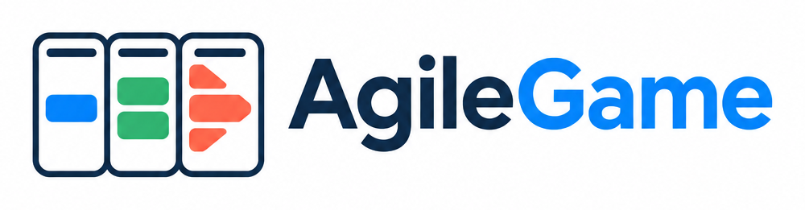
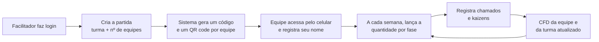
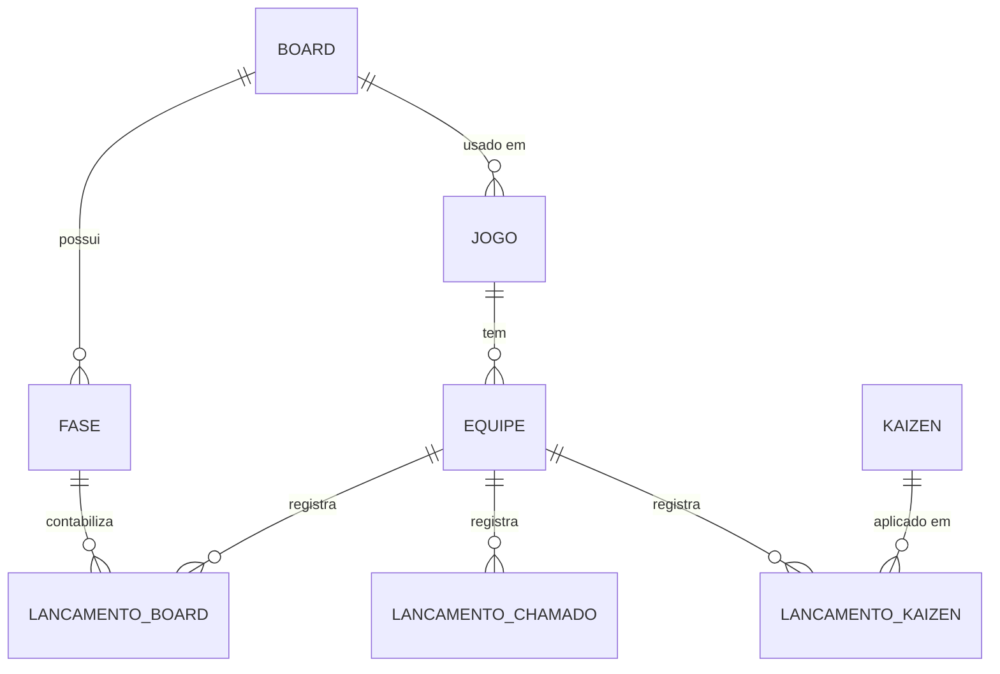

<p align="center">
  <picture>
    <source media="(prefers-color-scheme: dark)" srcset="docs/logo-dark.png">
    
  </picture>
</p>

<p align="center">
  Simulação de fluxo Kanban para treinar equipes em métricas ágeis, com quadros por equipe e Cumulative Flow Diagram em tempo real.
</p>

<p align="center">
  
  
  
  
  
</p>

---

## Sobre

O AgileGame apoia dinâmicas presenciais de Kanban. Um facilitador cria uma partida para uma turma, cada equipe entra pelo celular com um código ou QR code e, a cada "semana" simulada, registra quantos itens tem em cada coluna do seu quadro. O sistema transforma esses lançamentos em gráficos de fluxo cumulativo (CFD), por equipe e da turma inteira, para discutir gargalos, WIP e o efeito das melhorias escolhidas.

Além do quadro, as equipes registram **chamados** (demandas não planejadas que chegam durante o jogo) e **kaizens** (cartas de melhoria com custo de esforço e pré-requisitos), simulando as decisões de um time de sustentação de software.

O projeto foi desenvolvido entre novembro de 2018 e outubro de 2019; o histórico de commits está preservado neste repositório.

## Como o jogo funciona



### Quadro padrão: Sustentação

| Ordem | Fase | Abreviação | Cor |
|:-:|---|---|---|
| 0 | Backlog | Bklog | `#1E90FF` |
| 1 | Desenvolvimento | Dev | `#3CB371` |
| 2 | Pré-Homologação | P-Hml | `#FF6347` |
| 3 | Homologação | Hml | `#D3D3D3` |
| 4 | Deploy | Dep | `#FFEFD5` |
| 5 | Produção | Prd | `#D8BFD8` |

Boards e fases são cadastráveis, então é possível montar outros fluxos.

### Cartas de kaizen

Cada melhoria custa esforço da equipe, pode ser usada um número limitado de vezes e algumas dependem de outras.

| Carta | Melhoria | Esforço | Usos | Requer |
|:-:|---|:-:|:-:|:-:|
| A | Limitar WIP | 3 | 1 | — |
| B | Contratar dev | 15 | 1 | — |
| C | Disponibilizar dev para outro time | 8 | 3 | — |
| D | Treinar dev para atuar em pré-homologação | 9 | 1 | — |
| E | Pedir ao cliente mais esforço em homologação | 15 | 1 | — |
| F | Participar de treinamento | 12 | 3 | — |
| G | Equalizar time | 15 | 3 | — |
| H | Teste automatizado | 20 | 1 | — |
| I | One-click deploy | 18 | 1 | H |
| J | Continuous Delivery | 15 | 1 | I |

## Funcionalidades

- **Partidas por turma:** o facilitador define a turma, o board e a quantidade de equipes; cada equipe recebe um código de 5 caracteres.
- **Entrada por QR code:** a tela de registro mostra um QR code por equipe, que leva direto ao cadastro do nome.
- **Lançamento semanal:** a equipe escolhe a semana e informa a quantidade de itens em cada fase.
- **Chamados e kaizens:** registro com dia de início e conclusão; kaizens validados pela letra da carta.
- **Cumulative Flow Diagram:** gráficos Highcharts por equipe e consolidado da turma.
- **Cadastros administrativos:** boards, fases, partidas, equipes e lançamentos, com telas MVC e API REST.
- **Auditoria:** a tabela `LogGame` registra alterações (tabela, coluna, valor original e atual).

## Arquitetura

A solução `AgileGame/AgileGame.sln` tem três projetos em camadas:

```
AgileGame/
├── Domain/   Entidades (Jogo, Equipe, Board, Fase, Kaizen, Lançamentos) e utilitários
├── Data/     DbContext do Entity Framework 6, migrations e seed inicial
├── Web/      ASP.NET MVC 5 + Web API 2: controllers, views Razor, scripts e gráficos
└── Setup/    Projeto de instalador InstallShield (opcional, fora do build)
```



### Rotas

| Tipo | Padrão | Exemplos |
|---|---|---|
| MVC | `/{controller}/{action}/{id}` | `/Jogo/Create`, `/Jogo/Board/{codigoEquipe}`, `/Jogo/BoardsEquipe/{id}` |
| Web API | `/api/{controller}/{id}` | `/api/Board`, `/api/Jogo`, `/api/Kaizen`, `/api/LancamentoBoard`, `/api/LancamentoChamado` |

### Stack

| Camada | Tecnologia |
|---|---|
| Backend | C#, .NET Framework 4.5, ASP.NET MVC 5.2, Web API 2.2 + OData |
| Dados | Entity Framework 6.1 (Code First + Migrations), SQL Server / LocalDB |
| Frontend | Razor, Bootstrap 4, jQuery, Font Awesome 5, DataTables |
| Gráficos | Highcharts, Morris.js, Flot |

## Como executar

### Requisitos

- Windows com Visual Studio 2015 ou superior (workload ASP.NET)
- SQL Server LocalDB ou outra instância SQL Server
- IIS Express (incluído no Visual Studio)

### Passos

1. Abra `AgileGame/AgileGame.sln` no Visual Studio.
2. Restaure os pacotes NuGet (botão direito na solução → *Restore NuGet Packages*).
3. Se não for usar LocalDB, ajuste a connection string `DefaultConnection` em `AgileGame/Web/Web.config`.
4. No *Package Manager Console*, com o projeto padrão `Data`, rode:
   ```powershell
   Update-Database
   ```
   Isso cria o banco e carrega o seed: board "Sustentação", fases, cartas de kaizen e o usuário administrador.
5. Defina `Web` como projeto de inicialização e execute (F5).

### Acesso inicial

| Usuário | Senha |
|---|---|
| `master` | `agilegame01` |

Troque essa senha antes de usar o sistema fora do ambiente local.

### Compilar sem Windows (Docker)

Os projetos `Domain`, `Data` e `Web` compilam com Mono, o que serve para validar o build em macOS ou Linux. Isso não executa a aplicação, que depende de IIS e SQL Server.

```bash
docker run --rm -v "$PWD":/src -w /src/AgileGame mono:6.12 bash -c '
  nuget restore Web/packages.config  -PackagesDirectory packages &&
  nuget restore Data/packages.config -PackagesDirectory packages &&
  msbuild Web/Web.csproj /p:Configuration=Release /v:m'
```

## Limitações conhecidas

Este é um projeto de 2018–2019 mantido como registro; ele não recebeu atualizações desde então.

- **QR code:** a tela de registro gera o QR code pela Google Chart API, que foi descontinuada. É preciso trocar por uma biblioteca local (ex.: QRCoder) para essa parte voltar a funcionar.
- **Senhas em MD5:** o login compara hashes MD5, que não são adequados para senhas hoje.
- **Fonte de dados externa:** `Web/Scripts/js/morris-data.js` aponta para uma API de métricas que não está disponível publicamente.
- **Projetos não usados:** as pastas `AgileGame/AgileGame` e `AgileGame/WebApplication` são templates do Visual Studio que não fazem parte da solução.
- **Framework legado:** .NET Framework 4.5 e pacotes de 2014–2018. Uma evolução natural seria migrar para ASP.NET Core.

## Autor

Desenvolvido por **Uhitlei Barbosa**.

## Licença

Distribuído sob a [licença MIT](LICENSE).
